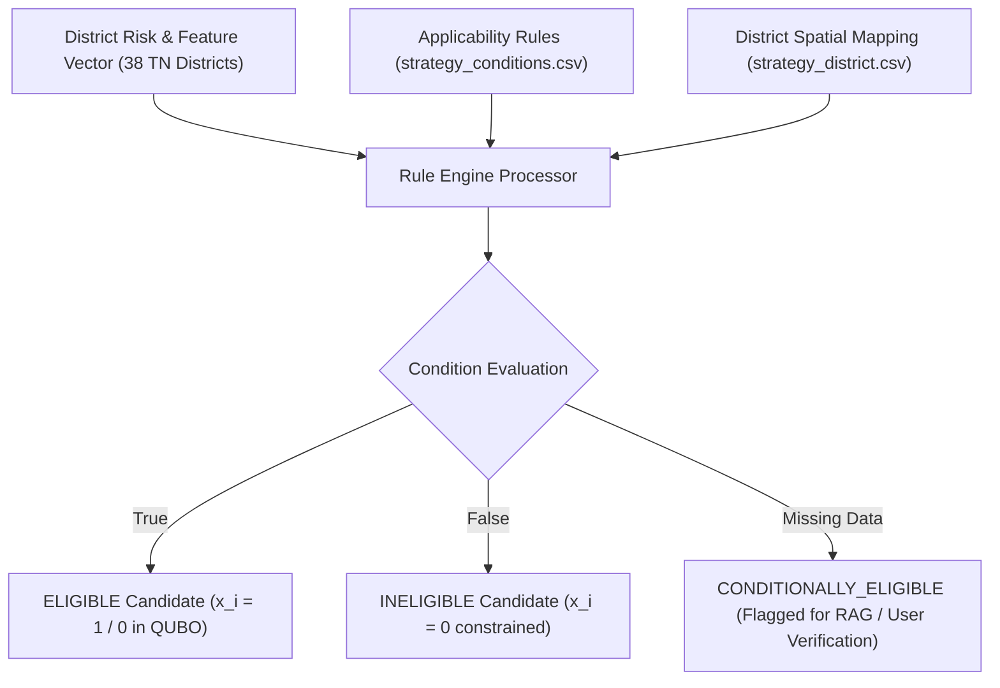

# Machine-Readable Strategy Applicability & Rule Engine Specification

**Version**: `v1.0.0_verified`  
**Target Region**: Tamil Nadu (38 Districts)  
**System Module**: Rule Engine & Applicability Evaluator  

---

## 1. Rule Engine Architecture

The **Applicability Rule Engine** evaluates binary eligibility and conditional suitability of each canonical adaptation strategy ($S_i$) for a specific district ($D_k$) based on its GIS, hydro-meteorological, and socio-economic feature vectors.



---

## 2. Evaluation Logic & Syntax Rules

Every condition expression in `strategy_conditions.csv` follows a strict, deterministic boolean logic syntax parseable by Python's `ast` / `sympy` evaluators:

### 2.1 Operators & Precedence
1. **Relational Operators**: `>=`, `<=`, `>`, `<`, `=`, `!=`, `IN`
2. **Logical Operators**: `AND` (conjunction), `OR` (disjunction), `NOT` (negation)
3. **Boolean Parameters**: Must evaluate to `TRUE` or `FALSE`.

### 2.2 Parameter Dictionary

| Parameter Name | Value Type | Description / Threshold Range | Source Feature Column |
| :--- | :--- | :--- | :--- |
| `urban_flood_risk` | ENUM | `LOW`, `MEDIUM`, `HIGH`, `VERY_HIGH` | Historical inundation depth & runoff modeling |
| `drain_blockage_index` | ENUM | `LOW`, `MEDIUM`, `HIGH` | Municipal silt & waste accumulation index |
| `impervious_surface` | FLOAT | `0.00` to `1.00` | Satellite land-use land-cover (LULC) impervious fraction |
| `cloudburst_vulnerability` | ENUM | `LOW`, `MEDIUM`, `HIGH` | IMD hourly rainfall intensity vulnerability |
| `roof_area` | FLOAT | Area in $m^2$ | Municipal building footprint GIS layer |
| `groundwater_depletion` | ENUM | `LOW`, `MEDIUM`, `HIGH`, `CRITICAL` | CGWB block-level groundwater extraction status |
| `lake_siltation` | ENUM | `LOW`, `MEDIUM`, `HIGH` | Eri reservoir capacity loss percentage |
| `agricultural_water_demand` | ENUM | `LOW`, `MEDIUM`, `HIGH` | District crop irrigation deficit indicator |
| `floodplain_encroachment_risk` | ENUM | `LOW`, `MEDIUM`, `HIGH` | River corridor building encroachment density |
| `roadside_space` | ENUM | `AVAILABLE`, `CONSTRAINED` | Right-of-way spatial buffer measure |
| `coastal_district` | BOOLEAN | `TRUE`, `FALSE` | Maritime coastal border indicator |
| `intertidal_mudflat` | ENUM | `AVAILABLE`, `UNAVAILABLE` | Coastal intertidal ecology presence |
| `shoreline_erosion_rate` | ENUM | `LOW`, `MEDIUM`, `HIGH` | NCCR shoreline retreat rate (m/year) |

---

## 3. Canonical Strategy Rule Registry

Below are the machine-executable applicability rule definitions for all 16 canonical strategies:

```json
[
  {
    "strategy_id": "STR-DRN-001",
    "rule_expression": "urban_flood_risk >= MEDIUM AND drain_blockage_index = HIGH",
    "fallback_action": "CONDITIONALLY_ELIGIBLE"
  },
  {
    "strategy_id": "STR-DRN-002",
    "rule_expression": "cloudburst_vulnerability = HIGH AND impervious_surface >= 0.70 AND land_availability = LOW",
    "fallback_action": "INELIGIBLE"
  },
  {
    "strategy_id": "STR-WTR-001",
    "rule_expression": "roof_area >= 50 AND groundwater_depletion = HIGH AND hydrogeology_suitable = TRUE",
    "fallback_action": "ELIGIBLE"
  },
  {
    "strategy_id": "STR-WTR-002",
    "rule_expression": "lake_siltation = HIGH AND agricultural_water_demand = HIGH AND community_support = TRUE",
    "fallback_action": "ELIGIBLE"
  },
  {
    "strategy_id": "STR-LND-001",
    "rule_expression": "floodplain_encroachment_risk = HIGH AND master_plan_updated = TRUE",
    "fallback_action": "ELIGIBLE"
  },
  {
    "strategy_id": "STR-LND-002",
    "rule_expression": "urban_expansion_rate = HIGH AND blue_green_ratio = LOW",
    "fallback_action": "CONDITIONALLY_ELIGIBLE"
  },
  {
    "strategy_id": "STR-NBS-001",
    "rule_expression": "impervious_surface >= 0.60 AND roadside_space = AVAILABLE",
    "fallback_action": "CONDITIONALLY_ELIGIBLE"
  },
  {
    "strategy_id": "STR-NBS-002",
    "rule_expression": "wetland_degradation = HIGH AND eco_restoration_possible = TRUE",
    "fallback_action": "ELIGIBLE"
  },
  {
    "strategy_id": "STR-BLT-001",
    "rule_expression": "flood_inundation_depth >= 0.5 AND grid_vulnerability = HIGH",
    "fallback_action": "ELIGIBLE"
  },
  {
    "strategy_id": "STR-BLT-002",
    "rule_expression": "road_waterlogging_frequency = HIGH AND heavy_vehicle_traffic = LOW_TO_MEDIUM",
    "fallback_action": "CONDITIONALLY_ELIGIBLE"
  },
  {
    "strategy_id": "STR-GIS-001",
    "rule_expression": "dem_resolution <= 5m AND terrain_slope = SUITABLE",
    "fallback_action": "ELIGIBLE"
  },
  {
    "strategy_id": "STR-CRT-001",
    "rule_expression": "hospital_flood_risk = HIGH AND back_up_power = CRITICAL",
    "fallback_action": "ELIGIBLE"
  },
  {
    "strategy_id": "STR-EWS-001",
    "rule_expression": "river_basin_flood_history = HIGH AND cellular_coverage = AVAILABLE",
    "fallback_action": "ELIGIBLE"
  },
  {
    "strategy_id": "STR-HTS-001",
    "rule_expression": "land_surface_temp = HIGH AND building_density = HIGH",
    "fallback_action": "ELIGIBLE"
  },
  {
    "strategy_id": "STR-CST-001",
    "rule_expression": "coastal_district = TRUE AND intertidal_mudflat = AVAILABLE",
    "fallback_action": "INELIGIBLE"
  },
  {
    "strategy_id": "STR-CST-002",
    "rule_expression": "coastal_district = TRUE AND shoreline_erosion_rate = HIGH",
    "fallback_action": "INELIGIBLE"
  }
]
```

---

## 4. Conflict & Compatibility Matrix Enforcements

When generating decision vectors for QUBO or Classical MILP optimization:
1. **Hard Conflicts ($x_A + x_B \le 1$)**:
   - `STR-DRN-002` (Underground Detention Vaults) vs `STR-NBS-001` (Deep-root Bioswales) in identical spatial sub-blocks due to underground structural conflicts.
2. **Prerequisite Dependencies ($x_A \le x_B$)**:
   - `STR-DRN-002` requires `STR-DRN-001` (Primary drain desilting must exist to accept pump outflow).
   - `STR-LND-002` requires `STR-LND-001` (Master planning relies on floodplain zoning enforcement).
   - `STR-CRT-001` requires `STR-BLT-001` (Hospital power retrofits require grid substation elevation).
   - `STR-CST-001` requires `STR-CST-002` (Mangrove sapling planting relies on offshore wave attenuation breakwaters in high wave energy zones).
